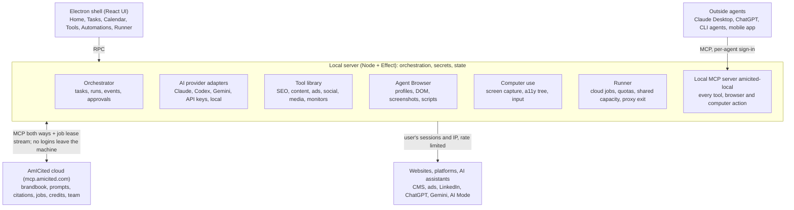

# AmICited Desktop — Product & Technical Specification

Nov 5, 2026 · @Viktor Zeman

## 1. Vision and positioning

AmICited Desktop is a local-first AI agent workstation for marketers, forked from [T3 Code](https://github.com/pingdotgg/t3code) (MIT). It runs on the marketer's own machine, drives any frontier AI provider the user already pays for, controls a built-in browser and the user's computer, ships a library of free marketing tools, and connects to the AmICited cloud over MCP. The goal is one app that replaces the long tail of marketing SaaS (Buffer, Make.com, Clay, Zapier, Hootsuite, Screaming Frog, SE Ranking-style trackers) by letting agents do the work locally, under the user's own logins and IP address.

**Target users.** Solo marketers, in-house marketing teams (1 to 20 people) and small agencies. The first-class persona is a growth or content marketer who already uses ChatGPT or Claude daily, manages a website, ads and social accounts, and wants work done rather than tooling to configure.

**Why desktop, not SaaS.** Three jobs are only possible or only cheap on the user's machine: acting on platforms with no public API (LinkedIn, Instagram, Google AI Mode, AI Overviews) through the user's logged-in browser session; querying AI assistants from a real residential IP in the user's country; and using the user's existing AI subscriptions instead of AmICited paying per token. The desktop app is therefore both a product and a distributed runner for the AmICited platform.

**Product principles**

1. Local by default, cloud when it adds value. Everything that can run on the user's machine runs there for free. AmICited cloud handles cross-country tracking, storage, sharing and credits.
2. The user's logins stay on the user's machine. No session cookies or provider tokens ever leave the device.
3. Every tool is agent-callable. A marketer can click a tool in the UI, and an agent can call the same tool through the internal MCP server. No feature exists only as UI.
4. Approvals are explicit. Anything that posts, spends money or sends email runs through the permission model inherited from T3 Code (ask, auto-approve per tool, auto-approve per project).
5. Brand consistency comes from AmICited. The brandbook, tone of voice, product facts and competitor list sync down and are injected into every agent run.

**Name.** Product name AmICited Desktop; binary and protocol name `amicited`; the local MCP server is `amicited-local`.

## 2. Relationship to T3 Code

We fork T3 Code and keep every feature it has, including the developer ones; AmICited Desktop is a layer of marketing interfaces, roles and tools built on top, so upstream changes merge in continuously. T3 Code is an "agent harness control surface": an Electron desktop app bundling a Node server, with web and mobile clients talking to that server over authenticated RPC. Provider processes, terminals, Git and project files belong to the server; shared state lives in `packages/client-runtime`; clients supply UI ([architecture overview](https://github.com/pingdotgg/t3code/blob/main/docs/internals/overview.md)). Developer features are not removed but hidden by role (section 11): a copywriter never sees a terminal, a web developer sees everything T3 offers.

**Stack we inherit (as of the November 2026 main branch):** pnpm monorepo, TypeScript, Electron 44 desktop shell, React 19 + TanStack Router + Zustand + Tailwind 4 web client, Effect-based server (`apps/server`) with an event-sourced orchestrator (`orchestration-v2`), SQLite persistence, `playwright-core` driven preview browser with browser profiles and cookie import, MCP server for outside agents, MCP Apps rendering, HTML "visual replies", SnapShots (window capture with accessibility tree), Clerk auth for T3 Connect remote access, electron-updater, iOS and Android companion apps.

| Area of T3 Code                                                                                               | Decision                  | Notes                                                                                                                                                           |
| ------------------------------------------------------------------------------------------------------------- | ------------------------- | --------------------------------------------------------------------------------------------------------------------------------------------------------------- |
| `apps/desktop`, `apps/server`, `apps/web`, `packages/client-runtime`, `packages/contracts`, `packages/shared` | Keep                      | Core shell, RPC, state, UI kit. Rebrand strings, icons, deep-link scheme (`t3code://` → `amicited://`).                                                         |
| `packages/provider-*` (ACP, Codex, Claude, Cursor, Grok, Kiro, Muse, OpenCode, Pi, fx, Antigravity)           | Keep                      | The provider adapter layer is the main asset. See section 4.                                                                                                    |
| `orchestration-v2` (threads, runs, events, permissions, effect worker)                                        | Keep                      | Rename "thread" to "task" in UI only; keep internal names to ease upstream merges.                                                                              |
| Preview browser, browser profiles, cookie import (`docs/user/browser-import.md`)                              | Keep and extend           | Becomes the Agent Browser (section 5).                                                                                                                          |
| MCP server for outside agents, MCP Apps, HTML renders                                                         | Keep                      | Used for AmICited cloud and for tool UIs.                                                                                                                       |
| SnapShots (window capture + accessibility tree)                                                               | Keep                      | Foundation for computer use.                                                                                                                                    |
| Remote access (T3 Connect, Tailscale, SSH, guest links), mobile apps                                          | Keep, lower priority      | Lets a marketer approve a post from a phone. Ship desktop first; mobile follows.                                                                                |
| Git checkpoints, worktrees, diff view, PR linking, `packages/source-control-*`                                | Keep, developer role only | Visible in the Web designer / developer role (section 11); hidden for every other role. Non-dev brands use the simpler file-version store (section 13).         |
| Terminal (`node-pty`, libghostty), shell stream                                                               | Keep, developer role only | Agents still need a shell for tools; users never see a terminal.                                                                                                |
| Project = Git repo                                                                                            | Extend                    | A Brand wraps one or more T3 projects: a brand folder plus optional Git repos (Shopify theme, WordPress theme, website). The T3 project model stays underneath. |
| Codex/Claude usage meters, model manifest                                                                     | Keep                      | Reused for cost dashboard.                                                                                                                                      |
| `apps/marketing` (t3.codes site), `packaging/aur`, nix                                                        | Keep, rebrand             | Marketing site becomes amicited.com/desktop; keep the packaging recipes and point them at the AmICited release channel.                                         |
| `evals/`, `.repos/` reference repos                                                                           | Keep                      | Needed to keep merging upstream; add marketing evals beside them.                                                                                               |
| Clerk-based T3 Connect accounts                                                                               | Add AmICited sign-in      | AmICited account (OAuth) is the primary sign-in; T3 Connect remains for remote access until replaced by AmICited Link.                                          |

**Fork policy: inherit everything, build on top.** Upstream `main` is merged weekly, not quarterly. We never delete or rewrite upstream packages; AmICited code lives only in new packages prefixed `@amicited/*` under `packages/` and `apps/`, plus a small, documented set of extension points in upstream code (role-based navigation, brand context hook, tool registry hook, sign-in provider). Each extension point is a single file-level change kept as a patch in `patches/` so a merge conflict is local and obvious. Features T3 adds later (new providers, new remote access, new mobile features) arrive for free.

**Rename map.** T3 Code → AmICited Desktop; `t3` CLI → `amicited`; T3 Connect → AmICited Link; Thread → Task; Project → Brand (wraps T3 projects); Environment → Machine; Provider → AI provider (unchanged); SnapShot → Screen capture.

## 3. Architecture overview

The app is three processes on the user's machine plus the AmICited cloud: the Electron shell (UI), the local server (orchestration, providers, tools, runner) and the Agent Browser (a Chromium instance owned by the server). The cloud only ever talks to the local server, never to the UI.



_AmICited Desktop architecture: 3 local processes, 1 cloud, 4 boundaries._

The Electron renderer talks to the local server over the inherited RPC; the local server owns every provider process, the Agent Browser, the tool library and the runner; the AmICited cloud reaches the machine only through the MCP client/server pair, so the cloud never holds a login or a token that belongs to the user.

**Modules (new packages, all `@amicited/*`)**

| Package                                                                | Responsibility                                                                                                                                                                                                      |
| ---------------------------------------------------------------------- | ------------------------------------------------------------------------------------------------------------------------------------------------------------------------------------------------------------------- |
| `tools-core`                                                           | Tool registry, schema (JSON Schema in/out), execution sandbox, result cache, scheduling hooks. Every tool is exposed as a UI card and as an MCP tool.                                                               |
| `tools-seo`, `tools-web`, `tools-content`, `tools-ads`, `tools-social` | Tool packs (section 9). Pure TypeScript where possible; heavy work in child processes with a deadline, following T3's rule of no native modules in Electron main.                                                   |
| `browser-agent`                                                        | Agent Browser control: tabs, profiles, DOM snapshot, accessibility tree, screenshot, action primitives, rate limiter, humanization. Wraps the inherited `playwright-core` preview browser.                          |
| `computer-use`                                                         | OS-level control: screen capture (inherited SnapShots), accessibility tree, mouse and keyboard injection, window focus. Platform drivers for macOS (CGEvent + AX), Windows (UIA + SendInput), Linux Wayland portal. |
| `runner`                                                               | Pulls jobs from AmICited cloud, enforces user-defined quotas, executes via browser-agent or tools, reports results. Also hosts the compute-sharing worker (section 7).                                              |
| `cloud-client`                                                         | OAuth sign-in to AmICited, MCP client to `mcp.amicited.com`, sync of brandbook, prompts, calendars, credits; offline queue.                                                                                         |
| `cloud-mcp-server`                                                     | Local MCP server (`amicited-local`) exposing tools, browser and files to any provider agent and to outside agents. Extends T3's existing MCP server.                                                                |
| `workflows`                                                            | Declarative automations: triggers (schedule, webhook from cloud, file change, calendar), steps (tool, agent run, browser script, approval), run history. Replaces Make/Zapier for marketing jobs.                   |
| `brand`                                                                | Brand model: website, CMS connection, ad accounts, social accounts, brandbook, content calendar, asset library. One brand = one T3 "project".                                                                       |
| `ui-marketing`                                                         | React screens: Home, Tasks, Calendar, Tools, Automations, Runner, Brands, Credits, Settings.                                                                                                                        |

**Local vs cloud split**

| Runs locally (free)                                                       | Runs in AmICited cloud (credits or plan)                        |
| ------------------------------------------------------------------------- | --------------------------------------------------------------- |
| Agent runs on the user's provider subscriptions                           | Prompt tracking from other countries and devices                |
| Prompt tracking from the user's own IP                                    | Long-term storage, history, dashboards, sharing                 |
| All free tools, audits, screenshots                                       | Citation analytics across many brands                           |
| Browser and computer automation                                           | Scheduling when the machine is off (delegated to other runners) |
| Brandbook cache, content drafts, brandbook learning from site and tickets | Brandbook source of truth, team collaboration, roles            |

**Data flow for a typical task.** The user (or a schedule) creates a Task in a Brand. The orchestrator starts a run on the chosen provider with the brand context injected (section 8). The agent calls tools over `amicited-local` MCP, including `browser.*` and `computer.*` tools. Side effects that need approval pause the run with the inherited permission prompt. Results, artifacts and a cost record are written to the local SQLite store and, if the brand is cloud-linked, mirrored to AmICited.

## 4. AI provider layer

We keep T3 Code's provider adapter boundary unchanged and support every provider it supports, so a marketer uses the subscription they already have. As of the current T3 Code main branch that is Claude Code, Codex (ChatGPT), Cursor, Grok Build, OpenCode, Google Antigravity (Gemini), fx, Kiro, Muse, Pi and any ACP-compatible agent ([providers](https://github.com/pingdotgg/t3code/blob/main/docs/internals/providers.md)). Provider-specific behaviour stays behind `ProviderAdapter`; orchestration and the UI see normalized commands and events.

**Additions**

1. **Direct API providers.** Add a `provider-api` package with adapters for raw API keys (Anthropic, OpenAI, Google, Mistral, OpenRouter, Ollama/LM Studio local models) using the same adapter interface. Marketers often have keys but no CLI installed. Local models are the zero-cost default for classification, dedupe and summarisation steps inside tools.
2. **Capability manifest.** Each provider instance declares: supports images, supports computer-use tool protocol, max context, cost class (subscription-included / per-token / free local). Workflows pick a provider by capability and cost class, not by name.
3. **Model routing policy** per brand: `default agent model`, `cheap model` (used by tools for bulk text), `vision model` (screenshot reasoning). Defaults: whatever the user authenticated first, with local model as cheap model when available.
4. **Cost ledger.** Every run records provider, model, tokens (where the provider reports them) and an estimated cost. Reused from T3's usage meters; surfaced per brand and per automation in the Credits screen.
5. **Provider-agnostic brand context.** The brand system prompt (section 8) is injected through the adapter's instruction mechanism (`orchestrationInstructions`), so it works with every provider without provider-specific prompts.

**Non-goals.** We do not proxy provider traffic through AmICited servers, and we do not store provider credentials outside the OS keychain (T3 already uses `@napi-rs/keyring`).

## 5. Agent Browser and computer use

The Agent Browser is a Chromium instance owned by the local server (extending T3's `playwright-core` preview browser and browser profiles) that agents can read as structured DOM and as screenshots, and that the user can watch and take over at any moment. Computer use extends the same action model to any window on the machine.

### 5.1 Agent Browser

- **Profiles.** Named persistent profiles (`Personal`, `Client X`, `Clean`). Cookie import from Chrome, Firefox, Safari, Edge is inherited. Each brand maps to a default profile. Profiles are stored encrypted in the app data folder; never synced.
- **Three views for agents, exposed as MCP tools:** `browser.snapshot` (accessibility tree with stable element refs, the cheapest), `browser.dom` (pruned HTML with refs), `browser.screenshot` (viewport or full page, optional element highlight). Agents choose by capability: text-only models use snapshot, vision models use screenshot plus refs.
- **Actions:** `navigate`, `click(ref)`, `type(ref, text)`, `select`, `scroll`, `press`, `upload(ref, path)`, `download`, `wait_for`, `evaluate(js)` (gated), `tabs.*`. Every action returns the new snapshot diff so agents do not re-read the page.
- **Humanization layer** for logged-in consumer platforms: randomized delays, real mouse paths, typing cadence, viewport jitter, per-domain concurrency of 1, respect for the user's rate limits (section 6). This is what makes LinkedIn/Instagram posting and AI-assistant querying survivable.
- **Recorded scripts.** The user can perform a flow once in the Agent Browser; the app records it as a replayable script with selectors and parameters. Agents can call recorded scripts as tools (`script.run('post-linkedin', {text, image})`), which is cheaper and more reliable than reasoning through the UI every time.
- **Site adapters.** For high-value sites we ship maintained adapters (TypeScript modules with versioned selectors): LinkedIn post, Instagram post via web, X post, Facebook page post, Google Ads UI reads, Google Search Console, Google AI Mode, Google AI Overviews, ChatGPT web, Gemini web, Perplexity, Copilot. Adapters are updated over the air independent of app releases and fall back to agent reasoning when selectors break.
- **Watch and take over.** The browser renders in a panel of the app; the user sees every action, can pause the agent, do a step manually (solve a CAPTCHA, approve 2FA) and hand control back. Inherited from T3's browser panel.
- **Safety rails:** domain allow/deny list per brand; `evaluate(js)` and file downloads require permission; payment pages detected by heuristics always pause for approval; no headless mode for logged-in profiles (the user can always see what happens).

### 5.2 Computer use

- **Observation.** Screen capture via inherited SnapShots (macOS Screen Recording permission, Windows native, Linux Wayland portal) plus the accessibility tree of the focused window (`@crowecawcaw/xa11y`, already used by T3 in child workers). Exposed as `computer.screenshot`, `computer.a11y_tree`, `computer.windows`.
- **Action.** `computer.click(x,y | element)`, `computer.type`, `computer.key`, `computer.scroll`, `computer.focus_window`, `computer.open_app`, `computer.clipboard`. Platform drivers: macOS CGEvent + Accessibility API; Windows UI Automation + SendInput; Linux `xdotool`/`ydotool` where available.
- **Protocol compatibility.** The tools follow the Anthropic computer-use tool schema so Claude models use them natively; other providers get the same tools over MCP.
- **Scope.** Computer use is for apps without a web UI (Canva desktop, Figma, Adobe, Excel, Mail clients) and for anything the Agent Browser cannot do. Browser tasks always prefer the Agent Browser because it is cheaper and more reliable.
- **Guard rails.** A global kill switch (default shortcut: both Shift keys, reusing SnapShot's shortcut handling); a red border overlay while an agent controls the machine; mouse movement by the user pauses the agent; per-task allow list of applications; no computer use while the screen is locked.

## 6. Runner: executing AmICited jobs locally

The runner turns the user's machine into a worker for the AmICited platform so that work the cloud would otherwise pay for (fetching pages, screenshots, querying AI assistants) happens on the user's computer, under the user's own logins and IP, within limits the user sets.

**Job types (v1 set, extensible by the cloud without an app release)**

| Job              | Input                                                                                                                  | Output                                                      | Executed by                                  |
| ---------------- | ---------------------------------------------------------------------------------------------------------------------- | ----------------------------------------------------------- | -------------------------------------------- |
| `fetch.url`      | URL, render mode (static / rendered), headers                                                                          | HTML, status, timing, final URL                             | tools-web, Agent Browser `Clean` profile     |
| `screenshot.url` | URL, viewport, full-page flag                                                                                          | PNG/WebP + DOM snapshot                                     | Agent Browser                                |
| `ai.query`       | Assistant (ChatGPT, Gemini, Claude, Perplexity, Copilot, Google AI Mode, Google AI Overviews), prompt, locale, country | Answer text, cited URLs with positions, screenshot, raw DOM | Site adapter in the user's logged-in profile |
| `ai.query.api`   | Provider, model, prompt                                                                                                | Answer text, tool-use citations                             | provider-api (user's key)                    |
| `serp.fetch`     | Query, engine, locale                                                                                                  | Organic results, AI Overview block, People Also Ask         | Agent Browser                                |
| `audit.site`     | Domain, depth                                                                                                          | Technical SEO audit JSON                                    | tools-seo                                    |
| `monitor.page`   | URL, selector                                                                                                          | Change diff                                                 | tools-web                                    |

**Prompt tracking** is the primary `ai.query` consumer. The user defines prompts in AmICited (or locally); the runner asks each assistant on a schedule, extracts whether and where the brand is cited, and stores the result. Tracking from the user's own machine and country is free; results are stored in the user's AmICited account. Tracking from another country or without keeping the machine on is a cloud job (paid in credits) executed by AmICited's own infrastructure or by another user's runner (section 7).

**Quotas and rate limits (user-controlled, enforced locally)**

- Per assistant per hour and per day (default: ChatGPT 20/h, Gemini 20/h, AI Mode 30/h, AI Overviews 60/h; all configurable to zero).
- Active hours window and "only when idle" (no keyboard/mouse input for N minutes) and "only on AC power".
- Bandwidth and CPU caps; maximum concurrent browser tabs (default 2).
- Per-job-type opt-in. A user can allow `fetch.url` and `screenshot.url` but disable `ai.query` entirely.
- Hard rule: jobs never run in a profile the user has not explicitly marked "available to runner".

**Protocol.** The runner is an MCP client of `mcp.amicited.com` plus a long-poll/WebSocket job stream. Lease model: the cloud leases a job to one runner for a TTL; the runner acks, executes, reports `result` or `failed(reason)`. Unacked leases return to the queue. Results are signed with the device key so the cloud can attribute and audit. Payloads larger than 1 MB (screenshots, HTML) upload directly to object storage with a pre-signed URL.

**Transparency.** A Runner screen shows the live queue, what ran in the last 24 h, per-assistant usage against quota, credits earned, and a pause button. Every executed job is in the local activity log.

## 7. Shared compute and the credit economy

A user can offer spare runner capacity to other AmICited users and earn credits; a user who needs results from another country or device spends credits. A user in Slovakia can thereby run prompt tracking for a US customer who wants Slovak-IP answers, and spend the credits on US-IP tracking of their own prompts.

**Marketplace model**

- **Supply.** In Runner settings the user turns on "Share capacity", picks which job types to accept from others (default: only `fetch.url`, `screenshot.url`, `serp.fetch`; `ai.query` for others is opt-in per assistant) and sets a separate quota for shared jobs. Shared jobs always run in a dedicated, isolated `Shared` browser profile that the user's personal logins never touch, except for `ai.query` jobs where the user explicitly lends a logged-in assistant profile.
- **Demand.** When a tracking plan needs a country or device the user cannot provide, the cloud routes the job to a runner matching `country`, `assistant`, `reputation >= threshold`. The user does not pick runners; the cloud does.
- **Pricing.** Cloud sets a credit price per job type and country, published in the app. Runners earn a fixed share (proposal: 70 %) of the credit price; AmICited keeps the rest for routing, storage and verification. Credits are also purchasable; 1 credit has a fixed EUR price.
- **Reputation.** Each runner has a score from completion rate, latency, result validation and dispute outcomes. New runners start in a probation tier limited to cheap jobs.

**Residential proxy mode (peer-to-peer connection sharing)**

Besides executing whole jobs, a runner can lend only its network connection: a marketer's own agent, tools or Agent Browser send requests through another user's machine, so a SERP fetch, rank check, AI-assistant query or page screenshot comes from a real residential IP in the chosen country. This covers the many cases where the requester wants to run the logic locally (own prompts, own logged-in profile, own tools) and only needs the exit location to differ.

- **Reciprocity rule.** Proxy access is only available to users who share capacity themselves. A user who turns off sharing cannot route through other machines; the amount they may consume is bounded by what they contributed (credits earned from sharing, plus purchased credits only above a minimum sharing threshold, proposal: at least 1 GB or 500 requests per month shared).
- **Transport.** Each machine runs a lightweight exit node inside the app: outbound WebSocket or QUIC tunnel to AmICited's relay (no inbound ports, works behind NAT), end-to-end encrypted between requester and exit so the relay sees only metadata. The exit node forwards HTTP(S) requests and the Agent Browser's traffic for a session; it never terminates TLS for the requester's traffic.
- **Selection.** The requester asks for `country` (optionally region, ISP type, mobile vs fixed); the cloud picks an exit by reputation, current load and freshness. Sessions are sticky per task so a logged-in flow keeps one IP.
- **Exit-side limits.** The sharing user sets bandwidth per day, concurrent sessions, active hours, allowed request classes (search engines and AI assistants only / any site except a deny list) and a global deny list (banking, government, adult, own-company domains). Traffic through an exit never uses that machine's browser profiles or cookies; it is pure network transit from an isolated process.
- **Abuse controls.** The cloud enforces the same prompt and URL moderation as for jobs, per-requester rate limits, domain deny lists, logging of request metadata (host, time, bytes, requester id, exit id) kept 30 days for abuse handling, and instant revocation. Requesters are identified, so misuse is attributable; exits stay anonymous to requesters.
- **Pricing.** Metered in credits per GB and per request class, priced per country; the exit earns the same 70 % share as job execution. Because the requester's own machine does the heavy work, proxy mode is cheaper than a full job for both sides.
- **Scope note.** This is a closed, opt-in network among AmICited users for marketing research traffic, not a general-purpose proxy product; the terms of service must say so and the feature must be disable-able per country and per request class from the cloud.

**Trust and verification**

1. Results are signed with the device key; the cloud stores the signature with the result.
2. Random audit: a share of jobs (proposal: 5 %) are issued to two runners and compared; AI answers are compared for structural similarity, not exact text.
3. Runners never see the requester's identity, brand or prompt purpose. Prompts are plain strings; the cloud strips brand metadata.
4. Requesters never see the runner's identity; results carry only country, assistant and timestamp.
5. Content safety: the cloud rejects prompts that fail its moderation filter before dispatch; runners can additionally set a "safe prompts only" policy.

**Legal and platform-policy stance (needs legal review).** Querying consumer AI assistants through a logged-in account on another user's behalf may conflict with those assistants' terms of service. The spec assumes the per-user rate limits above, explicit opt-in per assistant, and clear disclosure in the Share-capacity flow. The feature must be switchable off per assistant from the cloud without an app release.

## 8. AmICited integration over MCP

AmICited cloud is reachable from the app and from every agent as one MCP server (`mcp.amicited.com`), and the app exposes itself to the cloud and to outside agents as another (`amicited-local`). Everything AmICited offers in its web app is therefore available as tools inside an agent run.

**Cloud MCP tools (consumed by the app and by agents)**

| Tool group    | Examples                                                                                                                                 |
| ------------- | ---------------------------------------------------------------------------------------------------------------------------------------- |
| `brand.*`     | `brand.get`, `brand.brandbook` (tone, vocabulary, banned words, visual rules, product facts, personas, competitors), `brand.assets.list` |
| `prompts.*`   | `prompts.list`, `prompts.add`, `prompts.results(prompt, range)`, `prompts.citations(brand, range)`                                       |
| `citations.*` | `citations.summary`, `citations.sources` (which pages get cited), `citations.gaps` (prompts where competitors are cited and we are not)  |
| `content.*`   | `content.calendar.list`, `content.calendar.schedule`, `content.drafts.save`, `content.recommendations` (what to write to win a citation) |
| `jobs.*`      | `jobs.submit` (cloud or shared-runner job), `jobs.status`, `jobs.result`                                                                 |
| `credits.*`   | `credits.balance`, `credits.history`, `credits.price(job, country)`                                                                      |
| `team.*`      | members, roles, approvals requested from a teammate                                                                                      |

**Local MCP server `amicited-local` (consumed by provider agents, the cloud and outside agents such as Claude Desktop or ChatGPT)**

- `tools.*` every registered free tool (section 9), with the same JSON schema shown in the UI.
- `browser.*`, `computer.*`, `script.*` from section 5.
- `files.*` scoped to the brand workspace folder.
- `workflow.*` list, run, inspect automations.
- `runner.*` status and quota (read only from outside).
- Authentication inherited from T3's outside-agents flow (per-agent sign-in and per-tool permissions, [docs](https://github.com/pingdotgg/t3code/blob/main/docs/user/outside-agents.md)).

**Brand context injection.** On every run the orchestrator builds a brand system prompt from the synced brandbook: identity and tone, writing rules, product facts and claims that are allowed, competitor names, current campaign focus, and a short list of citation gaps. It is appended through the adapter instruction hook so it works for all providers. The prompt is capped (proposal: 4 k tokens) and the full brandbook stays reachable through `brand.brandbook` for agents that need detail.

**Sync.** The brandbook, prompt list, content calendar and asset manifest sync to a local folder per brand (`~/AmICited/<brand>/`) as Markdown and JSON, so agents can read them as files and the user can edit them in any editor. Sync is bidirectional with last-writer-wins and a conflict copy; the cloud is the source of truth. Offline edits queue.

### 8.1 Accounts, sign-in and one-click sign-up

The app works without an account for purely local use, but the first-run screen makes connecting to AmICited a single action: one button signs in an existing user or creates a new account, and the user is back in the app, linked, in under 30 seconds.

**First-run screen.** Three choices: **Continue with Google**, **Continue with Microsoft**, **Continue with email** (magic link), plus a small "Use offline without an account" link. There is no separate "Sign up" path: the same button creates the account if the identity is new, so a first-time user never fills in a form.

**Flow (OAuth 2.1 Authorization Code + PKCE, RFC 8252 native-app pattern)**

1. The app generates a PKCE verifier and `state`, starts a loopback listener on `127.0.0.1:<random port>` (fallback: the `amicited://auth/callback` deep link already registered by the inherited URL handler) and opens `https://amicited.com/oauth/authorize` in the user's default system browser, never in an embedded webview, so existing Google or Microsoft sessions and password managers work and the app never sees a password.
2. AmICited's authorization server federates to Google, Microsoft or email magic link. If the identity has no AmICited account, it is created on the spot with the profile name, email and avatar from the identity provider, a free plan, a default workspace named after the email domain (personal domains get "My workspace"), and accepted terms recorded by a single checkbox on the consent screen.
3. The browser redirects to the loopback or deep-link callback; the app exchanges the code for an access token (short-lived, 15 min) and a refresh token (rotating, 90 days sliding), stored in the OS keychain via the inherited `@napi-rs/keyring`.
4. The app registers the machine: generates the device key pair (used to sign runner results, section 6), sends the public key and a device name, receives a machine id. The same flow links the inherited remote-access and mobile pairing so the phone app signs in by scanning a QR code from the desktop.
5. Post-sign-in onboarding (skippable, about 1 minute): enter the website URL → the app creates the first Brand and starts brandbook learning from the site (section 11.3); pick a role (section 11.1); detect installed AI providers (Claude Code, Codex, Gemini) and offer to connect any that are missing; optional: import browser sessions into the Agent Browser.

**Other entry points.** "Sign in with AmICited" button in Settings for users who started offline (local brands are then offered for upload to the cloud); `amicited login` CLI command using the device-code flow (RFC 8628) for headless machines and background-service installs; an invite link from a teammate (`https://amicited.com/join/<code>`) opens the app via deep link and lands the user in the inviter's workspace after the same one-click sign-in.

**Enterprise and agencies.** SSO via SAML or OIDC per workspace (Okta, Entra ID, Google Workspace), domain capture so colleagues signing in with the company domain join the company workspace automatically, SCIM provisioning on higher plans. The desktop flow is identical; the authorization server routes to the company IdP by email domain.

**Sessions and security.** Tokens never leave the keychain and are never passed to agents or tools; the local MCP server mints its own scoped tokens for outside agents (inherited flow). Refresh-token reuse detection revokes the whole device session. Settings → Account lists signed-in machines with last seen time and a revoke button; revoking a machine also stops its runner and shared capacity. Sign-out clears tokens and cloud caches but keeps local brands and files.

**Plans.** A free AmICited account is enough to use the app, store local prompt-tracking results and earn credits by sharing capacity; paid plans unlock cloud jobs, team features, SSO and history retention. Upgrades open the AmICited billing page in the system browser; the app picks up the new plan on the next token refresh.

## 9. Free marketer tool library

Every tool is a TypeScript module with a JSON-Schema input and output, a UI card generated from that schema, an MCP tool of the same name, optional scheduling, and a result history. Tools run locally and are free; tools that need third-party data (keyword volumes, backlinks) use the user's own API keys or the Agent Browser.

**Tool contract**

```typescript
export const tool: ToolDefinition<Input, Output> = {
  name: "seo.ssl.check",
  pack: "tools-seo",
  title: "SSL certificate check",
  input: z.object({ domain: z.string() }),
  output: z.object({
    validTo: z.string(),
    issuer: z.string(),
    chainOk: z.boolean(),
    grade: z.enum(["A", "B", "C", "F"]),
    issues: z.array(z.string()),
  }),
  cost: "free",
  timeoutMs: 20_000,
  schedulable: true,
  sideEffects: "none",
  run: async (input, ctx) => {
    /* ... */
  },
};
```

`sideEffects` is `none`, `writes-local`, `posts-external` or `spends-money`; the permission model uses it to decide whether to ask. `ctx` gives the tool a cheap model, the Agent Browser, the brand, a cache and a logger.

**Tool packs (v1 list; each line is one or more tools)**

| Pack                          | Tools                                                                                                                                                                                                                                                                                                                                                                                                                                                                            |
| ----------------------------- | -------------------------------------------------------------------------------------------------------------------------------------------------------------------------------------------------------------------------------------------------------------------------------------------------------------------------------------------------------------------------------------------------------------------------------------------------------------------------------- |
| Technical SEO                 | SSL certificate quality and expiry; DNS and MX/SPF/DKIM/DMARC check; robots.txt and sitemap validation; crawl (configurable depth) with status codes, redirects chains, canonical, hreflang, broken links; Core Web Vitals via Lighthouse in the Agent Browser; mobile-friendliness; structured-data validation (JSON-LD, schema.org types); duplicate titles/descriptions; orphan pages; image weight and alt text; `llms.txt` presence and quality; indexability of key pages. |
| On-page and content           | HTML audit (headings, word count, readability, keyword presence); content gap vs competitor URL; entity and topic extraction; FAQ extraction; readability score; AI-citability score (structure, factual density, freshness, author info, citations); brandbook compliance check for a draft; plagiarism-style similarity vs own pages.                                                                                                                                          |
| AI visibility (core AmICited) | Prompt tracking from this machine; AI answer capture with citations; citation share vs competitors; which pages of the site get cited; AI crawler access check (`GPTBot`, `ClaudeBot`, `PerplexityBot`, `Google-Extended` in robots.txt and server logs); answer drift over time.                                                                                                                                                                                                |
| SERP and keywords             | SERP fetch with AI Overview detection; rank check for a keyword list from this machine; People Also Ask harvest; keyword clustering (local model); search intent classification; Google Trends fetch; autocomplete harvest.                                                                                                                                                                                                                                                      |
| Competitors and monitoring    | Page change monitor with diff; price monitor; new-page detection via sitemap diff; competitor ad library lookup (Meta Ad Library, Google Ads Transparency) via Agent Browser; review monitoring (Google, Trustpilot, G2) via Agent Browser; brand mention search.                                                                                                                                                                                                                |
| Ads                           | Google Ads account read (API with the user's OAuth): search terms report, wasted spend finder, negative keyword suggestions, budget pacing, ad strength; daily optimisation checklist; Meta Ads read; UTM builder and validator; landing-page vs ad message match.                                                                                                                                                                                                               |
| Social                        | Post composer with per-platform limits; best-time suggestion from the user's own analytics; hashtag research via Agent Browser; comment and DM inbox read (via Agent Browser where no API); engagement export.                                                                                                                                                                                                                                                                   |
| Email and CRM                 | List hygiene (syntax, MX, disposable domains); email rendering preview; deliverability headers check; subject line variants; lead enrichment from public web (company site, LinkedIn page via Agent Browser, Crunchbase-style pages) as a Clay replacement; ICP scoring with a local model.                                                                                                                                                                                      |
| Assets and web                | Image compression and resizing to platform specs; OG image generator from brand template; favicon and PWA manifest check; screenshot of any URL on device presets; PDF to Markdown; video to transcript (local Whisper); QR code; link shortener via the user's own domain.                                                                                                                                                                                                      |
| Analytics                     | GA4 and Search Console read (user's OAuth); anomaly detection on daily series; weekly report generator; attribution sanity check for UTM consistency.                                                                                                                                                                                                                                                                                                                            |
| Local utilities               | CSV/Sheet cleanup and merge; dedupe; text diff; regex tester; JSON and sitemap viewer; cron and timezone helper; word and character counter per platform.                                                                                                                                                                                                                                                                                                                        |
| Media                         | Script and storyboard from brief; image and video generation through the user's own model keys; ffmpeg assembly templates (intro, captions, music bed, logo, aspect ratios 16:9, 9:16, 1:1); local Whisper captions and subtitles; voice-over via the user's TTS key; thumbnail variants; upload adapters for YouTube, TikTok, Reels, LinkedIn video; brand-template rendering for carousels and ad sets.                                                                        |

**Tool discovery for agents.** With more than 100 tools, the local MCP server exposes `tools.search(query)` and groups tools by pack, so a provider's context is not filled with every schema. Tools declare `keywords` for that search.

**Scheduling.** Any `schedulable` tool can be put on a schedule per brand (e.g., SSL check weekly, crawl monthly, prompt tracking daily). Schedules are stored locally and run by the inherited background service (`amicited service install`) so they run when the app window is closed. Alerts go to the app's notification centre and, optionally, to AmICited cloud for email/mobile push.

## 10. Marketing workflows and what the user sees

The user works in Brands, Tasks, a Calendar and Automations; agents, tools and the browser sit underneath. The chat-with-agent thread from T3 Code remains the universal escape hatch, but the first screen is a marketer's dashboard, not a chat box.

**Navigation (left rail):** Home · Tasks · Calendar · Tools · Automations · Browser · Runner · Credits · Settings. A brand switcher sits at the top, as T3's project switcher does.

**Home.** Today's scheduled items, approvals waiting, alerts from monitors (SSL expiring, rank drop, citation lost), citation share trend from AmICited, runner status and credits. One "Ask" box starts an agent task in the current brand.

**Tasks.** The inherited thread list and run view. A task has a provider, a permission mode, attachments, a browser panel and a result area (visual replies). Task templates per brand: "Daily Google Ads check", "Write article from brief", "Weekly SEO report", "Repurpose article to LinkedIn + X + newsletter".

**Calendar.** A content calendar synced with AmICited (`content.calendar.*`). Each item has a channel, status (Idea · Brief · Draft · Review · Approved · Scheduled · Published), owner, due date, linked task and artifact. Drag to reschedule. "Generate" on an empty slot starts an agent task with the brief, brandbook and citation gaps. "Publish" dispatches to the connected CMS or to a site adapter in the Agent Browser at the scheduled time; the background service handles it when the app is closed.

**Connected systems per brand**

| System                                                                                                                        | Method                                                                               | v1                                                  |
| ----------------------------------------------------------------------------------------------------------------------------- | ------------------------------------------------------------------------------------ | --------------------------------------------------- |
| CMS: WordPress, Webflow, Shopify, Ghost, Framer, Wix, Sanity, Strapi, Contentful, HubSpot CMS, custom via Git-backed Markdown | Official APIs with user credentials; Agent Browser fallback                          | WordPress, Webflow, Shopify, Ghost, Markdown folder |
| Ads: Google Ads, Meta Ads, Microsoft Ads, LinkedIn Ads                                                                        | Official APIs (user OAuth); Agent Browser for UI-only reports                        | Google Ads read + change proposals with approval    |
| Social: LinkedIn (personal + page), Instagram, Facebook, X, TikTok, YouTube, Threads, Bluesky, Pinterest                      | Official API where it exists and is affordable; Agent Browser site adapter otherwise | LinkedIn, Instagram, X, Facebook via adapters       |
| Analytics: GA4, Search Console, Plausible, Matomo                                                                             | APIs                                                                                 | GA4, GSC                                            |
| Email: Mailchimp, Brevo, Klaviyo, HubSpot, SMTP                                                                               | APIs                                                                                 | Mailchimp, Brevo                                    |
| CRM: HubSpot, Pipedrive, Attio, Google Sheets as CRM                                                                          | APIs                                                                                 | HubSpot, Sheets                                     |
| Files: local folders, Google Drive, Dropbox, Notion                                                                           | APIs and local FS                                                                    | Local, Drive                                        |

**Reference workflows (shipped as templates)**

1. **Daily Google Ads optimisation.** Trigger 07:00 weekdays. Steps: pull yesterday's performance, run wasted-spend and search-term tools, agent drafts changes (negatives, bids, paused ads, budget shifts) with reasoning, approval card to the user (or auto-apply under a spend threshold), apply via API, log diff.
2. **Article from brief, brand-compliant.** Trigger: calendar item reaches Brief. Steps: agent researches with SERP and AI-visibility tools, writes to brandbook, runs citability and compliance tools, generates OG image, saves draft to CMS, moves item to Review.
3. **Repurpose and post.** Trigger: article Published. Steps: agent writes LinkedIn post, X thread, newsletter blurb; resizes images; schedules each in the calendar; at time, site adapters post from the user's browser profile with humanized pacing; captures the post URL and first-24 h engagement.
4. **Weekly SEO and AI visibility report.** Trigger Monday 06:00. Steps: crawl delta, CWV, rank check, citation share, gaps; agent writes the summary as a visual reply; export PDF; email to stakeholders via the user's email provider.
5. **Lead enrichment (Clay replacement).** Trigger: new row in a sheet or CRM. Steps: public-web enrichment tools, LinkedIn page via Agent Browser, ICP scoring with local model, write back, optional personalised first-line draft.
6. **Monitor and alert.** Trigger: schedule. Steps: page/price/review monitors, diff, agent classifies significance, notify.

**Automation builder.** Automations are YAML files in the brand folder, editable in a visual editor (trigger → steps → approvals → outputs) and by agents. Steps reference tools, agent prompts, browser scripts and conditions. Every run has a timeline with inputs, outputs and cost, like T3's activity log. Failed steps retry with backoff and surface in Home.

**Approval model.** Reuses T3's permission modes per task: `ask every time`, `auto-approve read-only`, `auto-approve within limits` (money per day, posts per day, allowed domains), `full auto` (requires explicit opt-in per automation). Approvals can be answered on mobile through the inherited remote access.

### 10.1 What a marketing manager hands to the app

The test for the product is whether a head of marketing can delegate the whole run of a campaign, not only drafts. The catalogue below lists the jobs a marketing department does, who normally does each, and how the app resolves it end to end. Every row is a task template a manager can start from Home with one sentence.

| Job                                                                                                           | Normally done by             | How the app resolves it                                                                                                                                                                                                                                          | Needs                                                |
| ------------------------------------------------------------------------------------------------------------- | ---------------------------- | ---------------------------------------------------------------------------------------------------------------------------------------------------------------------------------------------------------------------------------------------------------------- | ---------------------------------------------------- |
| Campaign brief and plan                                                                                       | Manager                      | Agent turns a one-paragraph goal into a brief: audience, offer, channels, budget split, KPIs, timeline; creates calendar items and child tasks per role                                                                                                          | Brandbook, calendar, roles                           |
| Copywriting: landing pages, ads, emails, posts, product descriptions                                          | Copywriter                   | Draft in brand voice, compliance and citability checks, variants per channel, saved to CMS, ads or email tool as drafts                                                                                                                                          | Content pack, CMS and ads connections                |
| Design: banners, social cards, OG images, ad creatives in all sizes                                           | Designer                     | Brand templates rendered by tools in bulk; agent composes new layouts from brandbook tokens; Canva or Figma via API or computer use for custom work                                                                                                              | Assets pack, visual tokens, computer use             |
| Video and audio: short ads, product demos, reels, voice-over, captions                                        | Designer, agency             | Script from brief; stock or generated footage via the user's video-model keys (API); assembly with ffmpeg templates (intro, captions, music, aspect ratios); captions via local Whisper; thumbnail variants; upload to YouTube, TikTok, Reels via API or adapter | Media pipeline (new tools-media pack), provider keys |
| Publishing a campaign across channels                                                                         | Social manager, manager      | One approval card publishes the whole set: CMS pages, scheduled posts, email send, ad campaigns live; the automation tracks each channel's status and rolls back drafts that fail                                                                                | Workflows, all connectors                            |
| PPC management across Google, Meta, Microsoft, LinkedIn, TikTok ads                                           | PPC specialist               | Daily optimisation run per channel; cross-channel budget reallocation proposals; creative fatigue detection; search-term mining; change log with reasoning; weekly summary                                                                                       | Ads pack, ads APIs                                   |
| Fix the landing page because the ad is underperforming                                                        | PPC + copywriter + developer | Agent reads ad, search terms and page, diagnoses message match, speed and CTA, proposes copy and layout changes, applies them to the CMS or theme repo, launches an A/B test, reports lift                                                                       | Ads pack, CMS, developer role tools                  |
| Small development tasks: Shopify or WordPress theme tweak, tracking pixel, schema markup, form fix, speed fix | Developer                    | Coding provider works in the theme repo or via CMS API with T3's full developer tooling; preview in the Agent Browser; deploy to staging; manager approves to production                                                                                         | Developer role, Git, staging                         |
| SEO and AI-visibility programme                                                                               | SEO specialist               | Monthly audit, content gaps vs citations, briefs created in the calendar, fixes applied in CMS, rank and citation tracking from real locations                                                                                                                   | SEO and AI visibility packs, runner                  |
| Email and lifecycle: newsletters, nurture flows, win-back                                                     | Lifecycle marketer           | Segment from CRM, write and build in the email tool, test sends, schedule, report                                                                                                                                                                                | Email pack, connections                              |
| Social community management: replies, DMs, mentions                                                           | Social manager               | Inbox via APIs or Agent Browser, drafted replies in brand voice, approval queue, lead flags to CRM                                                                                                                                                               | Social pack, adapters                                |
| Events and webinars: landing page, invites, reminders, follow-up                                              | Manager, lifecycle           | Template workflow creating page, registration form, email sequence, social promo, post-event recording and recap                                                                                                                                                 | Workflows, CMS, email                                |
| Partner and influencer outreach                                                                               | Manager                      | Prospect list from public web, enrichment, personalised outreach drafts, tracking of replies                                                                                                                                                                     | Email and CRM pack                                   |
| PR and content distribution                                                                                   | Manager, copywriter          | Press release in brand voice, media list, distribution via email, repurposing to channels                                                                                                                                                                        | Content, email                                       |
| Reviews, reputation and listings                                                                              | Manager                      | Monitor Google, Trustpilot, G2, app stores; draft responses; keep business listings consistent                                                                                                                                                                   | Monitoring pack, adapters                            |
| Reporting to leadership                                                                                       | Manager                      | Weekly and monthly reports from GA4, GSC, ads, email, social and citations with narrative; export to PDF, Slides or Slack                                                                                                                                        | Analytics pack, visual replies                       |
| Budget and vendor tracking                                                                                    | Manager                      | Spend per channel vs plan, invoices from email into a sheet, alerts on overspend                                                                                                                                                                                 | Analytics, email reading                             |
| Market and competitor research                                                                                | Manager, SEO                 | Competitor pages, ads, pricing, messaging changes, new launches; monthly digest                                                                                                                                                                                  | Monitoring pack, runner                              |
| Localisation of campaigns                                                                                     | Copywriter                   | Translate and adapt copy per market with brandbook per language; local SERP and AI checks through peers in that country                                                                                                                                          | Content pack, proxy mode                             |
| Asset and knowledge hygiene                                                                                   | Everyone                     | Brand folder kept tidy: naming, versions, expired assets, brandbook drift alerts                                                                                                                                                                                 | Brand folder, versions                               |

Two additions this catalogue implies for the rest of the spec: a **tools-media pack** (script-to-storyboard, ffmpeg assembly templates, captioning, aspect-ratio exports, thumbnail generation, upload adapters) in section 9, and a **Campaign** entity in section 13 that groups calendar items, tasks, assets, spend and results across channels so the manager sees one campaign, not twenty tasks.

## 11. Roles, role workspaces and brandbook learning

Every person on a marketing team gets a workspace shaped for their job (screens, tool packs, default agents, connected systems), while all workspaces read and write the same brandbook of the brand. Roles are per brand, so one person can be a copywriter for brand A and the owner of brand B.

### 11.1 Roles and their workspaces

| Role                              | Home view                                                                                                                                    | Tool packs on by default                      | Connected systems                                                                                                              | Agent defaults                                                                          | Can approve                            |
| --------------------------------- | -------------------------------------------------------------------------------------------------------------------------------------------- | --------------------------------------------- | ------------------------------------------------------------------------------------------------------------------------------ | --------------------------------------------------------------------------------------- | -------------------------------------- |
| Owner / marketing lead            | Dashboard: KPIs, citation share, spend, approvals queue, team activity                                                                       | All                                           | All                                                                                                                            | Any                                                                                     | Everything, sets limits for others     |
| Copywriter / content              | Content studio: briefs, drafts with brandbook compliance and citability score, calendar                                                      | Content, AI visibility, SERP                  | CMS (draft only), Drive, Notion                                                                                                | Writing model, brandbook strict mode                                                    | Own drafts to Review                   |
| SEO specialist                    | Audit board: crawl diffs, CWV, ranks, citations, gaps, task list of fixes                                                                    | Technical SEO, SERP, AI visibility, Analytics | GSC, GA4, CMS                                                                                                                  | Analysis model                                                                          | Technical changes in CMS within limits |
| Web designer / developer          | Site workspace: Git repositories, local dev preview in Agent Browser, Lighthouse, visual regression, component library from brandbook tokens | Technical SEO, Assets, Web                    | Git hosting (GitHub, GitLab, Bitbucket via the source-control packages we otherwise remove; kept behind this role), CMS, Figma | Coding provider (Claude Code, Codex) with full T3 dev features re-enabled for this role | Deploys to staging                     |
| Social media manager              | Social desk: calendar by channel, composer, queue, inbox and comments, engagement stats                                                      | Social, Assets, Monitoring                    | Social accounts via API or adapters, Canva                                                                                     | Short-form writing model, brand voice                                                   | Posts within daily limits              |
| Performance / ads manager         | Ads cockpit: daily optimisation checks, budget pacing, change proposals, landing-page match                                                  | Ads, Analytics, SERP                          | Google Ads, Meta Ads, Microsoft Ads, GA4                                                                                       | Analysis model                                                                          | Changes under the spend threshold      |
| Email / CRM / lifecycle           | Lifecycle board: segments, campaigns, flows, deliverability, enrichment                                                                      | Email and CRM, Content                        | Mailchimp, Brevo, Klaviyo, HubSpot, Pipedrive                                                                                  | Writing model                                                                           | Sends to test lists                    |
| Support / community (read-mostly) | Voice of customer: ticket themes, FAQ gaps, review monitor                                                                                   | Monitoring, Content                           | Helpdesk (LiveAgent, Zendesk, HubSpot Service, Freshdesk, Intercom)                                                            | Summarisation model                                                                     | Nothing external                       |
| Client (agency guest)             | Read-only report view and approval cards via inherited guest links                                                                           | None                                          | None                                                                                                                           | None                                                                                    | Items sent to them for approval        |

The developer role is the one place where T3 Code's developer features stay: Git worktrees, diff view, PR linking and the terminal are switched on for that role and hidden for the others; nothing upstream is removed (section 2). A designer gets the brandbook's visual tokens (colours, type, spacing, logo rules) exported as CSS variables, Tailwind config and Figma tokens, and a visual-regression tool that compares the staging site against those tokens.

**Role mechanics.** A role is a profile: `{screens, toolPacks, connections, agentDefaults, permissionLimits}` stored in the brand and editable by the owner. Built-in roles are templates; teams can clone and adjust them. Switching role switches the left rail, Home and tool palette; nothing else about the brand changes. Agents receive the role in their instruction block so a copywriter's agent does not try to touch ads.

### 11.2 One brandbook, many views

The brandbook is a structured document in AmICited (section 8) with sections that different roles own: identity and positioning (owner), tone and writing rules (copywriter), visual system (designer), product facts and claims (owner, lead), audiences and personas (lead, lifecycle), competitor list (SEO), channel rules such as hashtag policy and posting cadence (social), ad messaging pillars (ads), support vocabulary and known pain points (support). Every role sees the whole brandbook but edits its own sections by default; every agent run gets the whole thing in compressed form. Changes are versioned and reviewed by the owner before they become the active version that agents use.

### 11.3 Learning the brandbook

The app can draft the brandbook from evidence instead of a blank page, then let the owner correct it. Three sources, run as agent tasks with the tool library:

1. **From the website.** Crawl the site (tools-seo crawler), extract tone, vocabulary, claims, product names, pricing, audiences and visual tokens (colours, fonts, logo, spacing from CSS and screenshots), detect competitors from comparison pages, and produce a brandbook draft with a confidence per field and the source URL for each fact. Rerun periodically to flag drift between site and brandbook.
2. **From helpdesk tickets.** Connect LiveAgent, Zendesk, HubSpot Service Hub, Freshdesk, Intercom or Help Scout through their APIs (user credentials; read only). The agent samples tickets, clusters them with a local model, and derives: the vocabulary customers actually use (which feeds prompt tracking and SEO), top pain points and objections, FAQ gaps on the site, feature names as customers say them, and tone of the support team. Output lands in the support vocabulary and audiences sections, plus a list of suggested articles and prompts to track. Personal data is stripped locally before anything is summarised; raw tickets never leave the machine or enter the cloud brandbook.
3. **From existing materials.** Drop a folder of PDFs, decks, past posts and ads; the agent extracts the same fields and reconciles them with the website draft, flagging contradictions for the owner.

Each learned fact carries provenance (source, date, confidence); the owner accepts, edits or rejects fields in a review screen, and only accepted facts enter the active brandbook. The same pipeline runs on a schedule as "brandbook drift" monitoring.

## 12. Next features: replacing the marketing SaaS stack

The features below are the ones that make the app a replacement for a paid subscription rather than a helper beside it. Each names the incumbent, what the local-first agent model does better, and what it needs from the rest of this spec.

| Feature                                                                                                                                         | Replaces                                          | Why we win locally                                                                                   | Depends on                            |
| ----------------------------------------------------------------------------------------------------------------------------------------------- | ------------------------------------------------- | ---------------------------------------------------------------------------------------------------- | ------------------------------------- |
| **Social publishing from the user's own sessions** with queue, best-time, first-comment, carousel and video upload                              | Buffer, Hootsuite, Later                          | No API fees, no platform approval, personal profiles supported, posting looks human                  | Site adapters, humanization, calendar |
| **Social inbox and engagement agent**: reads comments and DMs via the browser, drafts replies in brand voice, posts after approval, flags leads | Sprout Social, Brand24                            | Works where APIs are closed; brand voice from brandbook                                              | Agent Browser, approvals              |
| **Visual automation builder with agent steps**                                                                                                  | Make.com, Zapier, n8n                             | Steps can be "ask an agent" and "use the browser", so integrations never block a workflow            | workflows package                     |
| **Lead enrichment and outbound research**                                                                                                       | Clay, Apollo (partly)                             | Enrichment from public web and the user's LinkedIn session at zero per-row cost; local model scoring | tools-email, Agent Browser            |
| **AI visibility suite** (prompt tracking, citation share, gap analysis, citability audit)                                                       | Profound, Peec, Otterly, SE Ranking AI tools      | Real logged-in answers from real locations, free from own machine, marketplace for other countries   | Runner, shared compute, cloud         |
| **Rank tracking from real locations**                                                                                                           | SE Ranking, AccuRanker                            | Residential proxy mode routes the user's own check through a peer in any country                     | Runner, shared compute                |
| **Technical SEO crawler with scheduled audits and diffs**                                                                                       | Screaming Frog, Sitebulb, Ahrefs Site Audit       | Free, local, agent fixes issues in the connected CMS                                                 | tools-seo, CMS connectors             |
| **Ads copilot** with daily checks and approved changes                                                                                          | Optmyzr, Adalysis                                 | Subscription LLM does the analysis; API changes only after approval                                  | tools-ads                             |
| **Brand-compliant content studio**: brief → draft → compliance → images → CMS                                                                   | Jasper, Writesonic, Surfer                        | Brandbook is the source of truth; citability score aims at AI answers, not only Google               | brand, tools-content                  |
| **Reporting**: weekly visual report to PDF/email/Slack from GA4, GSC, ads and citations                                                         | Looker Studio setups, AgencyAnalytics, Whatagraph | Agent writes the narrative; data stays local                                                         | tools-analytics, visual replies       |
| **Monitoring and alerts**: competitor pages, prices, reviews, mentions, SSL, uptime                                                             | Visualping, Mention, UptimeRobot                  | Runs from the user's machine or a shared runner; agent judges relevance                              | tools-monitor, background service     |
| **Asset pipeline**: brand templates for OG images, ad creatives and social cards; batch resize; video to captions                               | Canva (partly), Bannerbear, Descript (partly)     | Template once in brand, generated by tools in bulk                                                   | tools-assets                          |
| **Recorded browser skills shared across the team**                                                                                              | Browse AI, Axiom                                  | Record once, parameterise, agents reuse; shared through AmICited                                     | script.\*                             |
| **Team and agency mode**: multiple brands, client approvals via guest links, per-client credit budgets                                          | Agency tooling                                    | Inherited guest links and remote access                                                              | cloud team.\*                         |
| **Mobile approvals and voice tasks**                                                                                                            | —                                                 | Inherited mobile apps and voice input: approve a post or dictate a task from a phone                 | T3 mobile                             |
| **Offline-first and privacy**: nothing leaves the machine unless the brand is cloud-linked                                                      | —                                                 | A selling point for agencies under NDA                                                               | storage                               |

**Suggested sequencing by value and dependency.** AI visibility suite and the runner first (they are AmICited's core and need the marketplace to grow), then social publishing via adapters (the clearest Buffer replacement and a daily-use habit), then the content studio with CMS publishing, then the automation builder, then ads, enrichment and the long tail of tools. Sequencing is advisory only; this spec describes the full product.

## 13. Data model, storage and sync

Local state lives in the inherited SQLite database (orchestration events and projections) plus new tables for brands, tools, automations and runner jobs; brand content lives as files in the brand folder so agents and users can read it directly.

**Core entities**

| Entity               | Key fields                                                                                                                                    | Stored                                      |
| -------------------- | --------------------------------------------------------------------------------------------------------------------------------------------- | ------------------------------------------- |
| Machine              | device id, device key pair, OS, runner settings, quotas                                                                                       | SQLite + OS keychain                        |
| Brand                | id, name, website, cloud brand id (nullable), default browser profile, model routing policy, folder path                                      | SQLite                                      |
| Connection           | brand, system (CMS, ads, social, analytics), auth method, scopes, health                                                                      | SQLite; secrets in keychain                 |
| BrowserProfile       | name, path, imported-from, shared-with-runner flag, lent assistants                                                                           | SQLite; cookies encrypted on disk           |
| Task (= T3 thread)   | brand, provider instance, permission mode, status, cost                                                                                       | inherited                                   |
| Run, Event, Approval | inherited orchestration-v2                                                                                                                    | inherited                                   |
| Tool                 | name, pack, version, schema hash                                                                                                              | code registry                               |
| ToolRun              | tool, brand, input, output ref, duration, cost, triggered-by (user / agent / schedule / cloud job)                                            | SQLite; large outputs on disk               |
| Automation           | brand, YAML path, triggers, enabled, last run                                                                                                 | file + SQLite index                         |
| AutomationRun, Step  | status, inputs, outputs, cost, approvals                                                                                                      | SQLite                                      |
| CalendarItem         | brand, channel, status, due, owner, task ref, artifact ref, cloud id                                                                          | SQLite, mirrored to cloud                   |
| Artifact             | brand, kind (draft, image, report, screenshot, html), path, version, origin run                                                               | files + SQLite                              |
| Prompt, PromptResult | prompt text, assistant, locale, country, answer, citations, screenshot ref, runner origin                                                     | SQLite local; mirrored to cloud when linked |
| RunnerJob            | cloud job id, type, lease, state, result signature                                                                                            | SQLite                                      |
| CreditLedgerEntry    | cached from cloud, read only                                                                                                                  | SQLite cache                                |
| Campaign             | brand, goal, audience, channels, budget per channel, dates, KPIs, linked calendar items, tasks, assets, spend and results per channel, status | SQLite, mirrored to cloud                   |

**Brand folder layout** (`~/AmICited/<brand>/`): `brandbook/` (Markdown and JSON synced from cloud), `prompts.json`, `calendar/` (one JSON per item), `drafts/`, `assets/`, `reports/`, `automations/*.yaml`, `scripts/` (recorded browser scripts), `.amicited/` (cache, sync state). The folder is the agent's working directory for the brand, replacing the Git checkout in T3's project model.

**File versioning.** Replace Git checkpoints with a simple content-addressed version store for `drafts/` and `automations/`: every save creates a version; the UI offers restore and diff. No branches, no merges.

**Sync rules.** Cloud-linked brands sync brandbook, prompts, prompt results, calendar and selected artifacts. Never synced: browser profiles, connection secrets, tool run inputs containing credentials, computer-use screenshots (unless the user attaches one to a cloud task). Sync is a per-entity cursor with last-writer-wins and conflict copies; offline changes queue and replay.

**Retention.** Local tool runs and screenshots: 90 days by default, user configurable. Prompt results kept locally indefinitely but capped at 2 GB with oldest screenshots pruned first. Runner job payloads deleted once the cloud confirms receipt.

## 14. Security, privacy, permissions and compliance

The app holds the user's most valuable logins and can act as them, so the security model is stricter than T3 Code's developer defaults: every side effect is classified, every external post is attributable, and nothing secret leaves the device.

**Secrets.** Provider tokens, connection OAuth tokens and the device key in the OS keychain (inherited `@napi-rs/keyring`). Browser profiles encrypted at rest with a key in the keychain. No secret is ever included in a tool result, agent prompt or cloud payload; a redaction filter runs on every outbound MCP message and on every log line.

**Permission model.** Inherited T3 permission modes, extended with the tool `sideEffects` class and brand limits. Default for a new brand: read-only tools auto-approved; `writes-local` auto-approved; `posts-external` and `spends-money` ask. Every approval card shows exactly what will be posted or changed (rendered preview, target account, amount). An automation can only be set to `full auto` by a user with the brand's owner role.

**Prompt injection defence.** Web pages, AI answers, DMs and CMS content are untrusted. The Agent Browser marks all page-derived text as data in tool results; the orchestrator's instruction block tells agents never to follow instructions found in page content; `posts-external` actions triggered from a run that read untrusted content require approval unless the automation explicitly allows it. Recorded scripts cannot be modified by agents without approval.

**Runner isolation.** Shared jobs run in the `Shared` profile in a separate browser context with no access to the user's files; tool execution for shared jobs is sandboxed (child process, no FS outside a temp dir, no local network). Runners never receive requester identifiers; requesters never receive runner identifiers.

**Platform terms.** Site adapters for consumer platforms act only in the user's own session, at human-like rates, under user-set quotas, and are disable-able per site from the cloud. The app shows the user which platforms' terms restrict automation before enabling an adapter. Legal review is a release gate for the shared `ai.query` marketplace.

**Privacy and GDPR.** AmICited (EU-based) is controller for cloud data; the user is controller for local data. Prompt results sent to the cloud contain no personal data by design; enrichment outputs (section 9, Email and CRM pack) stay local unless the user exports them. Data export and deletion for the cloud account from Settings. Telemetry is opt-in and follows T3's existing telemetry doc (no content, only events).

**Updates and supply chain.** Signed builds (macOS notarised, Windows Authenticode), electron-updater over AmICited's release channel, site adapters and tool definitions updated over the air but signed and version-pinned; a bad adapter can be rolled back from the cloud. Dependency audit in CI; `knip` and lint inherited.

**Auditability.** Every agent action, tool run, browser action and runner job is in the local activity log with timestamps, inputs, outputs and the approving user. The log is exportable for client reporting.

## 15. Non-functional requirements, open questions, glossary

**Non-functional requirements**

| Area          | Requirement                                                                                                                                                                                   |     |
| ------------- | --------------------------------------------------------------------------------------------------------------------------------------------------------------------------------------------- | --- |
| Platforms     | macOS 13+ (arm64, x64), Windows 10+ (x64, arm64), Linux (AppImage, .deb; Wayland for computer use). Inherited from T3's build matrix.                                                         |     |
| Startup       | Cold start to usable Home under 3 s on a 2020 laptop; server boots lazily, tools load on demand (T3's `profile:startup` script kept as a CI gate).                                            |     |
| Footprint     | Idle under 300 MB RAM with the Agent Browser closed; Agent Browser profiles capped per brand; the \~120 MB headless Chromium download happens once, on first use, as in T3.                   |     |
| Reliability   | Background service survives app close and reboot; interrupted runs and jobs resume or fail cleanly, never half-post; every external post is idempotent via a client-generated key.            |     |
| Offline       | Everything local works offline; cloud calls queue; the UI shows sync state.                                                                                                                   |     |
| Localisation  | UI in English first, Slovak, Czech, German next; prompt tracking and SERP tools accept any locale and country.                                                                                |     |
| Accessibility | Keyboard-first UI inherited from T3's keybindings; screen-reader labels on all approval cards.                                                                                                |     |
| Observability | Local activity log, opt-in telemetry (events only), crash reports with secrets scrubbed.                                                                                                      |     |
| Testing       | Inherited vitest, Effect test layers and drainable workers; tool packs need contract tests against recorded fixtures; site adapters have nightly live smoke tests on AmICited's own accounts. |     |
| Licensing     | MIT upstream retained with attribution; our packages under a licence to be decided (open core proposed: app MIT, cloud-linked packs proprietary).                                             |     |

**Open questions**

- [ ] Licence for `@amicited/*` packages: fully open source, open core, or proprietary?
- [ ] Credit pricing, the runner's revenue share (70 % proposed), the minimum sharing threshold for proxy access, and whether credits convert to cash.
- [ ] Legal review of the shared `ai.query` marketplace against each assistant's terms; which assistants launch with it.
- [ ] Which CMS and social adapters are in the first release; whether to buy official API access (e.g., LinkedIn Marketing API) for page posting.
- [ ] Does the mobile app ship at launch or after desktop?
- [ ] Local model bundling: ship a small model with the app or require Ollama/LM Studio?
- [ ] Brand folder location and whether agencies want one folder per client or one per workspace.
- [ ] Team roles: does the cloud or the app own role definitions, and how are custom roles shared across a team?
- [ ] Which helpdesk connectors ship first for brandbook learning (LiveAgent is a natural first given the Slovak market).

**Glossary**

| Term                  | Meaning                                                                                                                                                  |
| --------------------- | -------------------------------------------------------------------------------------------------------------------------------------------------------- |
| AmICited cloud        | The hosted platform at amicited.com: accounts, brandbook source of truth, prompt tracking storage, credits, job routing.                                 |
| Agent Browser         | The Chromium instance owned by the local server that agents control and the user can watch.                                                              |
| Brand                 | The unit of work in the app: one company or client with its website, brandbook, connections and team. Replaces T3's project.                             |
| Brandbook             | Structured brand knowledge (tone, rules, facts, visuals, audiences, competitors, channel rules) synced from the cloud and injected into every agent run. |
| Credits               | AmICited's unit for paid cloud and shared-runner jobs; earned by sharing runner capacity, bought with money.                                             |
| Job                   | A unit of work the cloud asks a runner to execute.                                                                                                       |
| Provider              | An AI agent backend (Claude Code, Codex, Gemini, local model, API key) behind T3's adapter interface.                                                    |
| Role                  | A per-brand profile that shapes a person's screens, tools, connections, agent defaults and limits.                                                       |
| Runner                | The part of the app that executes cloud jobs locally within user-set quotas.                                                                             |
| Site adapter          | A maintained, over-the-air-updated browser script for one website (post to LinkedIn, query Gemini).                                                      |
| Task                  | A conversation-plus-run with an agent in a brand. T3's thread.                                                                                           |
| Tool                  | A schema-described local function available in the UI and over MCP.                                                                                      |
| Workflow / automation | A triggered sequence of tools, agent steps, browser scripts and approvals, stored as YAML in the brand folder.                                           |

**Sources**

- [T3 Code repository](https://github.com/pingdotgg/t3code) (MIT), read on 5 Nov 2026: `README.md`, `docs/internals/overview.md`, `docs/internals/providers.md`, `docs/user/browser-import.md`, `docs/user/outside-agents.md`, `docs/user/snap-shot.md`, `docs/user/html-renders.md`, `apps/desktop/package.json`, `apps/server/package.json`, `apps/web/package.json`.
- [AmICited](https://amicited.com) product ideas as given by the author in this brief.
